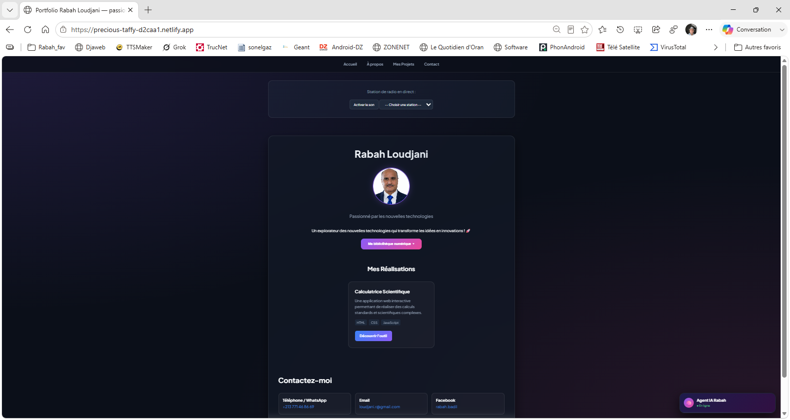

# Portfolio Rabah Loudjani

Ce projet est une page web personnelle conçue comme un portfolio pour présenter mon parcours, ma passion pour les nouvelles technologies et mes coordonnées. Avec un design moderne, coloré et réactif, il offre une expérience utilisateur fluide et visuellement attrayante et en bonus vous avez droit à la musique 🎵 | http://radios.rtbf.be/laprem1ere-128.mp3 | https://stream.europe1.fr/europe1.mp3 | http://radios.rtbf.be/pure-128.mp3



## Aperçu

La page est structurée en trois sections principales :

* **Accueil** : Une introduction accueillante avec un appel à l'action pour en savoir plus.
* **À propos** : Une présentation personnelle avec une photo de profil et une description de mes intérêts.
* **Contact** : Un formulaire interactif et des liens vers mes coordonnées (Email, WhatsApp, GitHub).

Le design repose sur un dégradé vibrant, une navigation fixe, des effets visuels (ombres, transitions, flou) et une mise en page optimisée pour tous les écrans.

## Fonctionnalités

* **Navigation intuitive** : Menu sticky pour un accès rapide aux sections.
* **Formulaire de contact** : Champs pour nom, email et message, avec un bouton stylisé.
* **Liens sociaux** : Liens directs vers Email, WhatsApp et GitHub.
* **Design réactif** : Adapté aux mobiles, tablettes et ordinateurs grâce à Flexbox.
* **Effets visuels** : Dégradé de fond, ombres, transitions au survol et effet de flou (backdrop-filter).

## Technologies utilisées

* **HTML5** : Structure sémantique avec des sections bien définies.
* **CSS3** : Styles avancés avec dégradés, Flexbox, animations et filtres.
* **Images externes** : Logo et photo de profil hébergés sur Imgur.

## Prérequis

Aucun logiciel ou dépendance spécifique n'est requis. Un navigateur web moderne (Chrome, Firefox, Safari, etc.) suffit pour visualiser la page.

## Installation et exécution

1. Clonez ce dépôt :
   
```bash
   git clone [https://github.com/djawed23/my-portfolio.git](https://github.com/djawed23/my-portfolio.git)